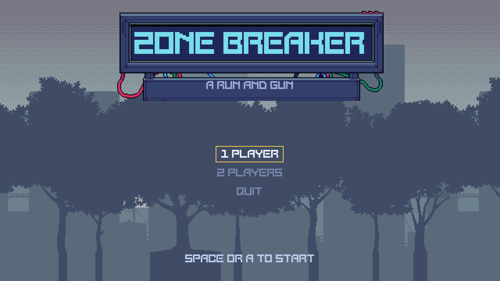
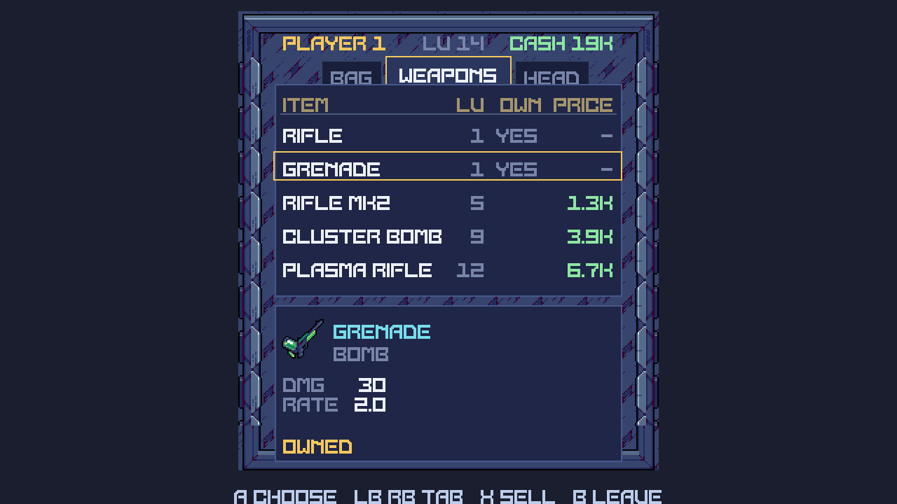
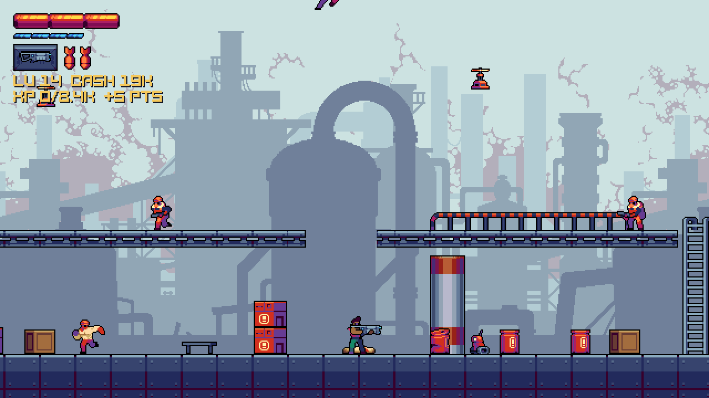
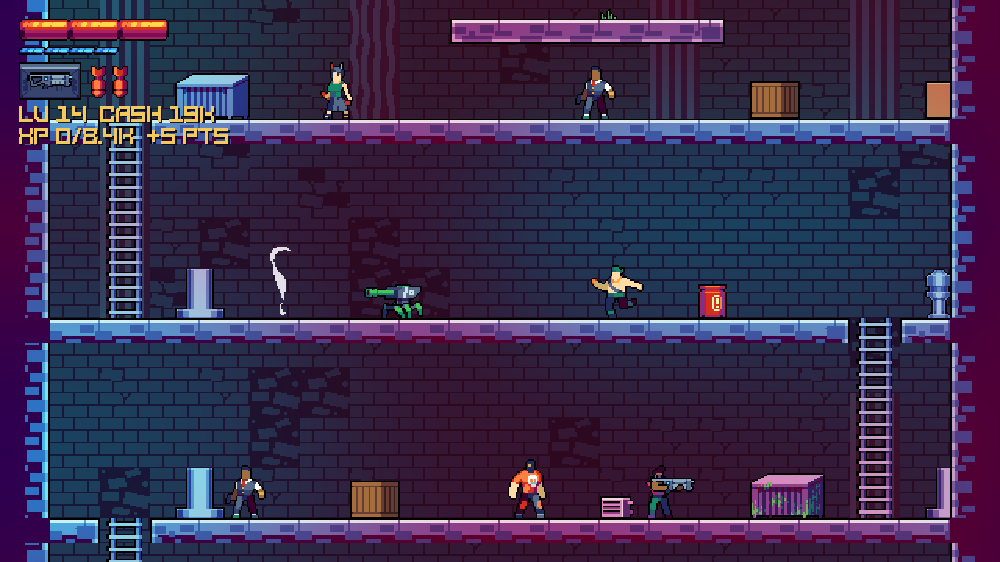
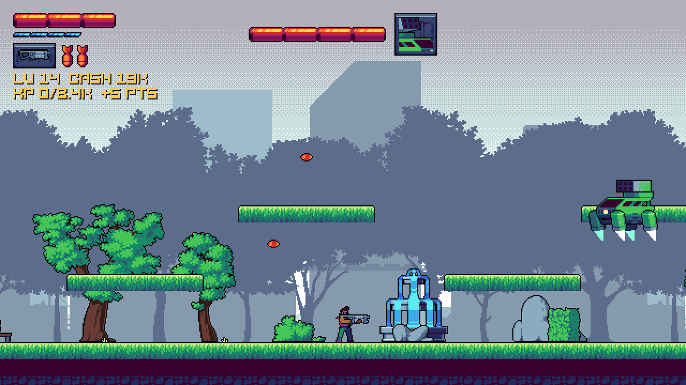
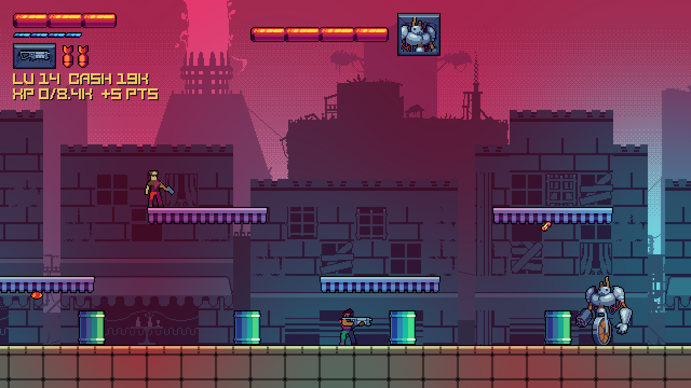

# ZONE BREAKER

A 2D pixel-art run-and-gun in the spirit of classic arcade shooters, with RPG progression and
local two-player co-op. Built with **Godot 4.7** and statically typed **GDScript**.

Fight through a series of zones — a green park, an industrial plant, a neon bar street at night and a
vertical basement shaft — each with its own enemies, traps and boss. Levels are layered: floors, ladders
and gaps connect multiple routes, and most segments force a detour (drop down, clear a lower floor,
climb back up) instead of a straight run to the right.

**Status:** 4 of 23 planned stages are playable. See the **[roadmap](ROADMAP.md)** for what is done
and what comes next.

> **About the graphics in this repository**
>
> The game's sprites, tiles, effects, UI font and some music come from third-party asset packs whose
> licenses do not allow redistributing them. **The public repository therefore ships without that art**:
> if you run it, you will see placeholder graphics — coloured blocks for characters and terrain, and
> Godot's default font in the menus. Gameplay, levels and rules are exactly the same.
>
> **The screenshots below show what the actual game looks like** with the art in place.

## Screenshots

**Title screen**



**Shop**



**Stage 2 — industrial zone**



**Stage 4 — basement shaft (vertical climb)**



**Stage 1 boss**



**Stage 3 boss**



## Features

- **Contra-style shooting**: 8-direction aiming, prone/crawl, drop-through platforms, sprint with
  stamina, grenades, and a screen-clearing ultimate.
- **Layered levels** generated from grid maps, with ladders, hydraulic presses, blast gates,
  conveyor belts, breakable crates and explosive barrels that chain-react.
- **Vertical stage**: an only-upward scrolling shaft climb where falling off the bottom of the screen
  costs health.
- **Enemy variety**: patrolling gunners with diagonal fire, chargers, lungers, leapers, armoured brutes
  that take reduced frontal damage, drones, grenadiers and self-destructing bots — plus four bosses
  with distinct patterns and an enraged second phase.
- **RPG progression**: XP and levels, four upgradeable stats (life / attack / defense / speed),
  money, a shop, eight gear slots and level-gated equipment. Progress is kept on death.
- **Local co-op**: two players on one screen, shared camera, revive a downed partner, separate
  progression per player, per-player gamepad assignment.
- **Swappable skin packs**: all visuals, effects, music and sound go through a skin-pack layer, so
  swapping art never changes game rules (enforced by tests).
- **Character roster saves**, three playable characters, stage select and unlocks.

## Running

Requires [Godot 4.7](https://godotengine.org/) (standard build, not .NET).

```sh
godot --path . --editor   # open in the editor
godot --path .            # play
```

The project starts on the main menu (`scenes/ui/main_menu.tscn`).

### Controls

| Action | Keyboard | Gamepad (Xbox layout) |
|---|---|---|
| Move | A / D or ← / → | Left stick / D-pad |
| Jump | Space / ↑ | A |
| Aim up / down | W / S | Stick or D-pad up / down |
| Drop through platform | Down + Jump | Down + A |
| Prone | Ctrl | LT |
| Sprint | Alt | LB |
| Shoot | J | RT |
| Switch weapon | Shift | RB |
| Ultimate | K | Y |
| Pause | Esc | Start |

## Tests

The project has a plugin-free behaviour test suite (`tests/`, 100+ suites, ~44,000 checks). Tests
instantiate real scenes, simulate input and step physics frames, so they catch problems static checks
miss — wrong collision layers, broken jump arcs, stuck AI states, levels that can no longer be
completed.

```sh
# all suites
godot --headless --path . --script res://tests/run_tests.gd

# a single suite, e.g. ladders
godot --headless --path . --script res://tests/run_tests.gd -- ladders
```

The runner exits with code 0 when everything passes. Any `SCRIPT ERROR` during a test counts as a
failure, and each test has a 60-second watchdog.

## Project layout

| Path | Contents |
|---|---|
| `scenes/` | Godot scenes (levels, actors, UI, traps) |
| `scripts/` | Gameplay, AI, UI, RPG and skin-layer scripts |
| `tests/` | Behaviour tests and the test runner |
| `levels/`, `characters/`, `weapons/`, `armor/` | Content resources, discovered by scanning folders (DLC-friendly) |
| `progression/` | Balance data (`balance.tres`) |
| `skins/<pack>/` | Skin packs: sprites, tiles, effects, HUD, music, sound |
| `tools/` | Python asset and level generators (level maps, path checker, sprite/tile/sound builders) |
| `art_src/` | Original source art and map paintings |
| `docs/screenshots/` | Screenshots of the game with the full art (for this README) |

Levels are not hand-placed: `tools/level_build.py` turns grid maps (`tools/level*_map.py`) into scenes,
and a path checker verifies every level is completable — the exit is reachable, forced detours really
are forced, and chargers never run off into pits.

```sh
python tools/level_build.py          # regenerate all levels
python tools/level_build.py --check  # check only, write nothing
```

## How it was made

This project was developed with AI pair-programming (Claude Code). I directed the game design, level
design and balance, play-tested each step, reviewed screenshots and decided what to change; the AI
assistant wrote most of the code and tests under that direction. Commits are co-authored accordingly.

## Assets and licensing

Most sprites, tiles, effects, the UI font and some music are derived from third-party asset packs
(CraftPix). The original packs are not included in this repository, and those assets remain subject
to their original licenses — they are not covered by any license of this repository and may not be
reused outside this project. Placeholder sound effects in `skins/default/` are generated by
`tools/sfx_gen.py`, and the art in `art_src/` is original.

### Public build without the third-party art

The public repository leaves the third-party packs out (`skins/cyberpunk`, `skins/industrial`,
`skins/bar_street`, `skins/basement` and their scenes in `scenes/skins/`). The game is built to cope:

- characters, enemies and effects fall back to the built-in placeholder skin (`skins/default/`),
- level terrain is drawn as plain coloured blocks instead of tiles,
- menus use Godot's built-in font instead of the pixel font,
- gear icons and decorations are simply left out.

Game rules are identical either way — art never changes collision, damage or timing. Tests that check
the art itself skip themselves when it is missing (`GameTest.needs_art()`), and the runner reports how
many were skipped. `tools/export_public.py` produces the public tree from the full one.
